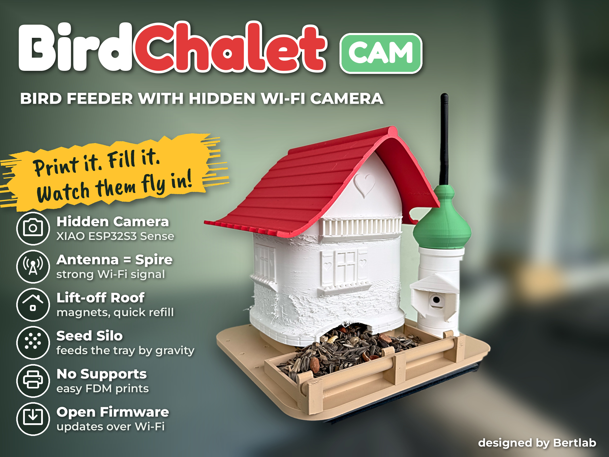
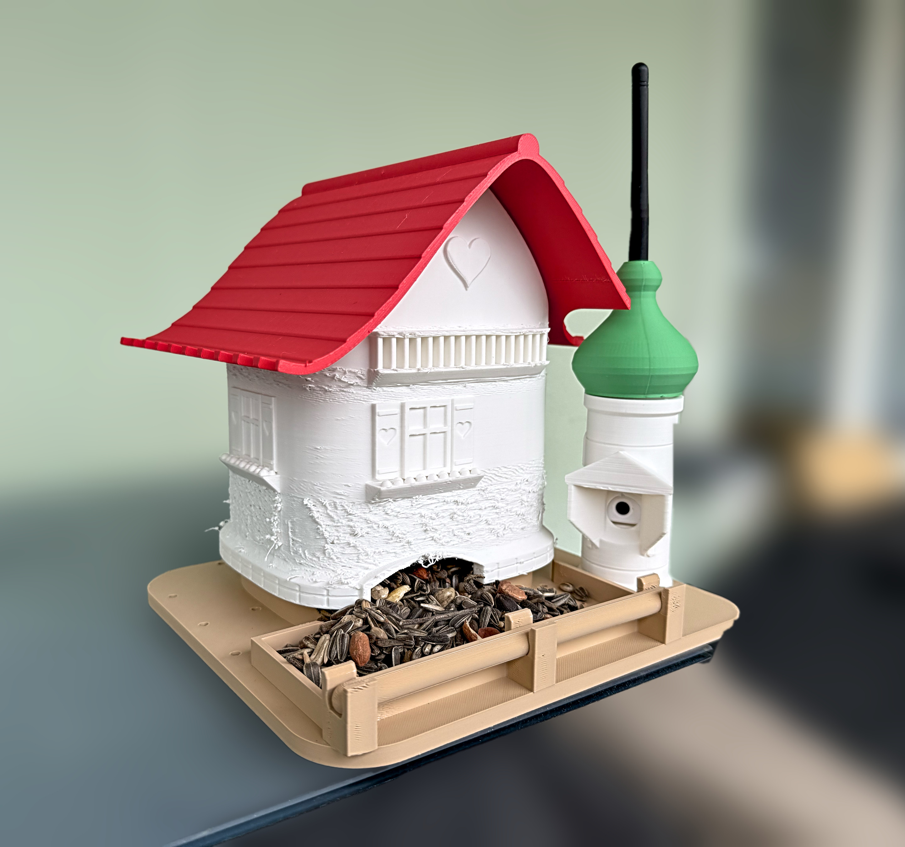
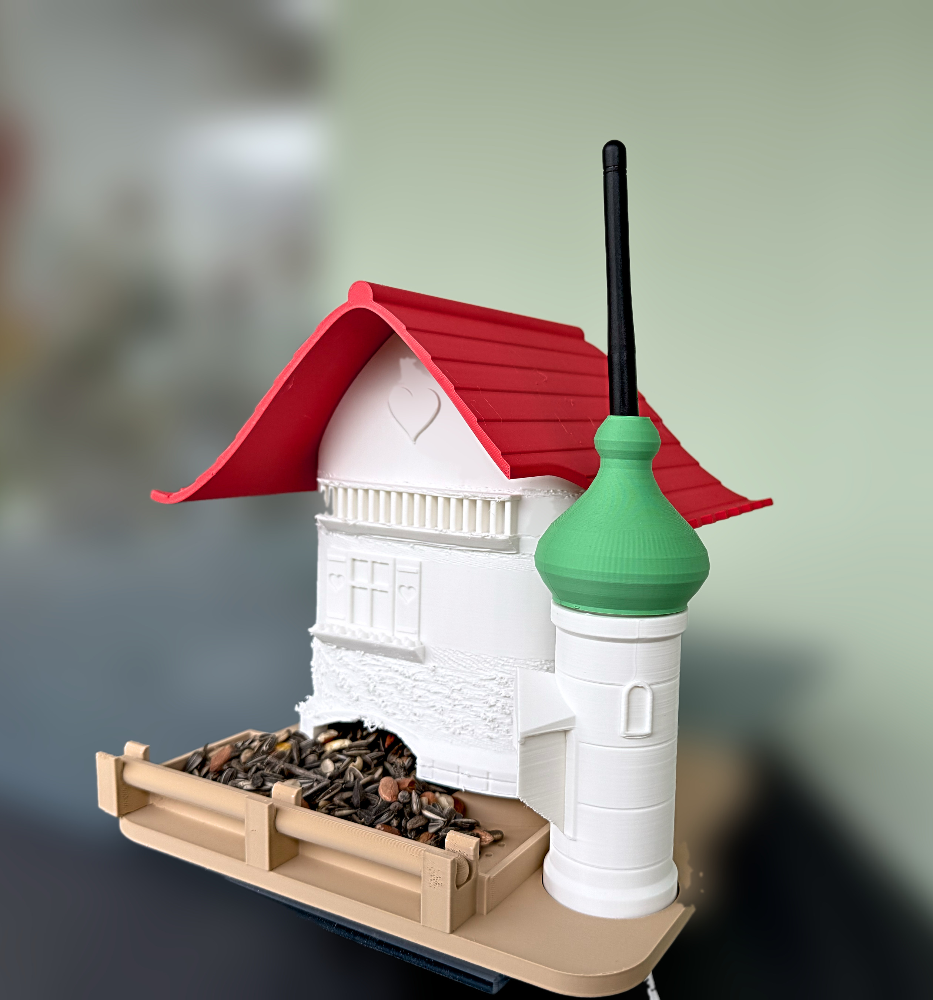
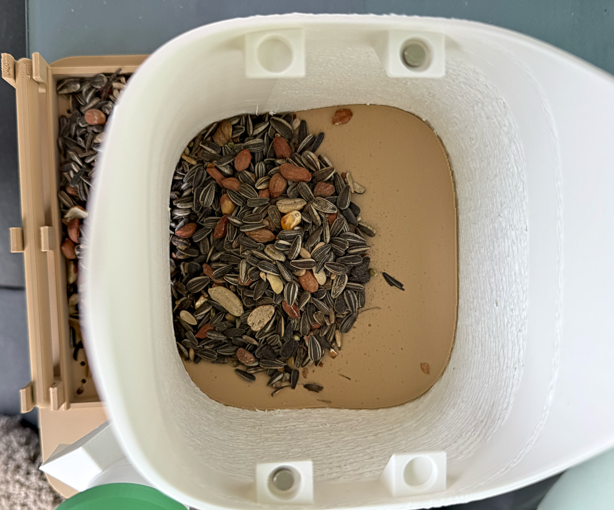
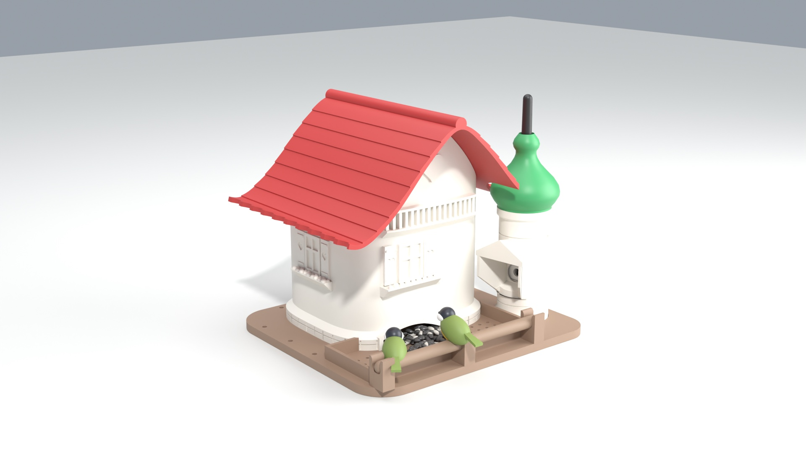
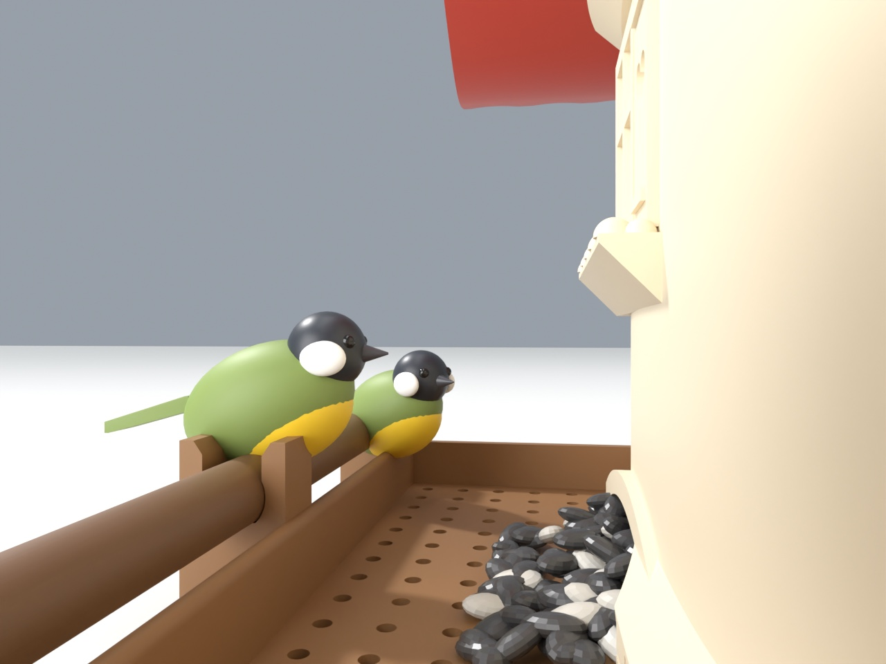
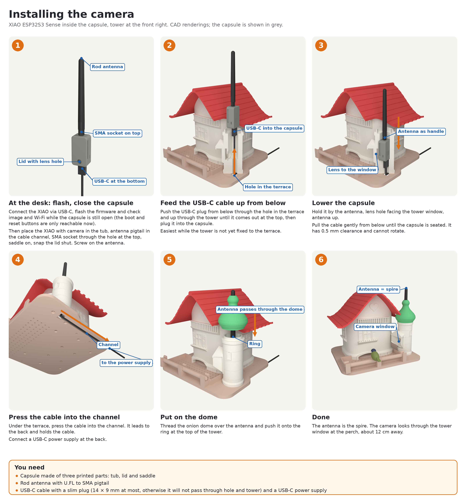

# BirdChalet CAM – bird feeder with a hidden Wi-Fi camera tower



A 3D-printed bird feeder in the shape of a little alpine chalet. The round tower next to the house
hides a **Seeed Studio XIAO ESP32S3 Sense** camera, the rod antenna doubles as the spire, and the
roof lifts off (magnets) to refill the seed silo. The camera looks through the tower window straight
at the perch, about 12 cm away.

This repository contains everything you need to build one:

| Folder | Content |
|---|---|
| [`stl/`](stl) | all printable parts as STL |
| [`3mf/`](3mf) | the Bambu Studio projects we printed from (X1 Carbon, 0.4 mm nozzle) |
| [`firmware/BirdhouseCam/`](firmware/BirdhouseCam) | Arduino sketch for the camera (Wi-Fi first, OTA updates, diagnostics) |
| [`docs/`](docs) | camera installation sheet (PNG and PDF) |
| [`images/`](images) | photos and renderings |

## Where to get it

The model is also published on the usual platforms:

- Printables: https://www.printables.com/model/1924215-birdchalet-cam-bird-feeder-with-wi-fi-camera
- MakerWorld: https://makerworld.com/en/models/3656035-birdchalet-cam-bird-feeder-with-wi-fi-camera
- Thingiverse: https://www.thingiverse.com/thing:7438334
- Cults3D: https://cults3d.com/en/3d-model/home/birdchalet-cam-bird-feeder-with-wi-fi-camera
- Thangs: https://thangs.com/designer/Bertlab3D/3d-model/BirdChalet%20CAM%20-%20Bird%20Feeder%20with%20Wi-Fi%20Camera-1663097

## Photos

| | |
|---|---|
|  |  |
| The printed feeder: terrace with seed tray and perch, house, lift-off roof, camera tower | Tower side: the antenna runs through the onion dome |
|  |  |
| Roof off: the silo slopes feed the tray by gravity; magnet pockets in the corners | Rendering of the assembly |

The camera's point of view (rendering, standard lens):



## Parts to print

| Part | File | Size (mm) | Material we used | Notes |
|---|---|---|---|---|
| Terrace with seed tray | `stl/terrace.stl` | 226 × 203 × 75 | PLA Matte, brown | drain holes in the tray, cable channel underneath |
| Perch | `stl/perch.stl` | 164 × 10 × 8.5 | PLA Matte, brown | snaps into the three forks |
| House (silo) | `stl/house.stl` | 155 × 137 × 176 | PLA Matte, white | |
| Camera tower | `stl/camera_tower.stl` | 60 × 53 × 105 | PLA Matte, white | rain hood above the lens window |
| Roof | `stl/roof.stl` | 210 × 85 × 173 (as printed, on its gable) | PLA Matte, red | printed standing, use a brim |
| Onion dome | `stl/onion_dome.stl` | Ø 58 × 63 | PLA Matte, green | the antenna passes through it |
| Camera capsule | `stl/capsule_tub.stl`, `capsule_lid.stl`, `capsule_saddle.stl` | 46 × 25 × 30 | ABS, white | holds the XIAO, drops into the tower |

Assembled size: footprint 226 × 203 mm, about 195 mm high (without the antenna).

### Print settings

All projects in [`3mf/`](3mf) are the ones we printed on a Bambu Lab X1 Carbon with a 0.4 mm
nozzle: 0.20 mm layers, 4 walls, 20 % grid infill (capsule 40 %), **no supports**.

| Project | Slicer estimate | Filament |
|---|---|---|
| `terrace_and_perch_pla.3mf` | 7 h 05 min | 375 g |
| `house_and_camera_tower_pla.3mf` | 7 h 15 min | 374 g |
| `roof_pla.3mf` (8 mm brim) | 4 h 33 min | 212 g |
| `onion_dome_pla.3mf` | 51 min | 36 g |
| `camera_capsule_abs.3mf` | 36 min | 10 g |
| **Total** | **about 20 h 20 min** | **about 1 kg** |

Tips from our own build:

- Slow down the outer walls for the white house. At the default 200 mm/s the stone base and the
  window sills come out rough (you can see it in our photos). 60 to 80 mm/s looks much cleaner.
- Our terrace was printed with only 2 walls (288 g) and is stiff enough as well.
- PLA is fine for a sheltered balcony. For a spot in full sun or rain use ASA or PETG.

## Hardware

| Qty | Item |
|---|---|
| 1 | Seeed Studio XIAO ESP32S3 Sense (with the stock OV3660 camera; the wide 160° module does not fit the capsule) |
| 1 | 2.4 GHz rod antenna with U.FL to SMA pigtail |
| 1 | USB-C cable with a slim plug (14 × 9 mm at most) and a USB power supply |
| up to 8 | neodymium disc magnets 10 × 3 mm (4 pairs; 2 pairs are enough) and a drop of glue |
| 8 | 3.5 mm screws for plastic, about 12 mm long (6 for the house, 2 for the tower, from below) – optional, the parts also sit well without |
| 1 | clear disc Ø 24 × 1 mm for the tower window – optional |

The terrace has four holes for M5 threaded inserts (Ø 6.4 × 10 mm, pattern 50 × 40 mm) on the
underside for a mount of your choice. A railing mount is not included.

## Assembly

1. Glue the magnets into the pockets of the house and of the roof. Check the polarity before the
   glue sets.
2. Snap the perch into the forks of the terrace.
3. Put the house on the terrace (screw it from below if you like).
4. Install the camera – see the sheet below.
5. Fill the silo through the open top, put the roof on.



## Firmware

The sketch in [`firmware/BirdhouseCam`](firmware/BirdhouseCam) is based on the `CameraWebServer`
example of the Arduino core for the ESP32 and adds what a camera inside a sealed tower needs:

- **Wi-Fi first**: the board joins the network even if the image sensor does not answer.
- **Over-the-air updates** (ArduinoOTA, port 3232, password protected) – after the first USB flash
  you never have to take the capsule out again.
- **Diagnostics** as JSON on `http://<camera>:8080/diag` (sensor state, error code, uptime, reset
  reason, signal strength, chip temperature, free memory).
- The sensor init is retried every 30 s, and a watchdog reconnects the Wi-Fi.
- Camera endpoints as in the example: web UI on port 80, still image on `/capture`,
  MJPEG stream on `http://<camera>:81/stream`.

### Credentials

There are **no credentials in this repository**. Copy `wifi_secret.example.h` to `wifi_secret.h`
and enter your own Wi-Fi name, Wi-Fi password and an OTA password of your choice. `wifi_secret.h`
is listed in `.gitignore`.

### Build and flash

Tested with arduino-cli 1.1.1 and the esp32 core 3.1.3 (the sketch compiles to about 1.07 MB).
You need `arduino-cli` with the esp32 core installed (`arduino-cli core install esp32:esp32`) and
`esptool` (`pip install esptool`).

```sh
cd firmware
cp BirdhouseCam/wifi_secret.example.h BirdhouseCam/wifi_secret.h   # then edit it

FQBN="esp32:esp32:XIAO_ESP32S3:PSRAM=opi,PartitionScheme=default_8MB"
arduino-cli compile --fqbn "$FQBN" --export-binaries --output-dir build BirdhouseCam

# First time, via USB-C (writes bootloader, partition table and app).
# PORT is the serial port of your board: /dev/ttyACM0 on Linux, /dev/cu.usbmodem... on macOS,
# COM3 or similar on Windows. `arduino-cli board list` shows it.
PORT=/dev/ttyACM0
esptool.py --chip esp32s3 --port "$PORT" --baud 921600 write_flash 0x0 build/BirdhouseCam.ino.merged.bin

# Every later update over Wi-Fi. espota.py is part of the esp32 core; this finds it:
ESPOTA="$(find "$(arduino-cli config get directories.data)/packages/esp32/hardware/esp32" -name espota.py | head -1)"
python3 "$ESPOTA" -i birdhouse-cam.local -p 3232 -a "<your OTA password>" -f build/BirdhouseCam.ino.bin -r
```

If `birdhouse-cam.local` does not resolve on your network, use the IP address of the camera.

`partitions.csv` in the sketch folder provides the two app slots that OTA needs on the 8 MB flash.
In our feeder the camera sits upside down in the tower; flip the image in whatever software reads
the stream (or with the `vflip`/`hmirror` controls of the web UI).

**Security note:** only the OTA update is password protected. The web UI, the still image, the
stream and the diagnostics page have no login, like in the original example. Run the camera in
your own trusted home network only and do not expose it to the internet.

The firmware only streams. What you do with the stream is up to you – watch it in a browser, record
it, or feed it into a bird detector.

## Kurzfassung auf Deutsch

Futterhaus zum Drucken in Form eines kleinen Alpenhäuschens. Im runden Turm sitzt eine
XIAO ESP32S3 Sense als WLAN-Kamera, die Stabantenne ist zugleich die Turmspitze, das Dach hält mit
Magneten und lässt sich zum Nachfüllen abheben. Alle Teile drucken ohne Stützen (0,20 mm, 4 Wände,
20 % Füllung; zusammen rund 20 Stunden und 1 kg Filament). Im Ordner `firmware/` liegt der
Arduino-Sketch: WLAN zuerst, Updates per WLAN, Diagnose auf Port 8080. Zugangsdaten stehen nicht im
Repository; `wifi_secret.example.h` kopieren und die eigenen Werte eintragen.

## Licence

This repository contains material under different licences. Full texts are in [`LICENSES/`](LICENSES).

| What | Licence |
|---|---|
| 3D models (`stl/`), project files (`3mf/`), photos and renderings (`images/`), documentation (`docs/`, this README) | © 2026 Bertlab, [CC BY-NC-SA 4.0](LICENSES/CC-BY-NC-SA-4.0.txt) – share and adapt for non-commercial use, with attribution, under the same licence |
| `firmware/BirdhouseCam/app_httpd.cpp` | unchanged from the `CameraWebServer` example of [arduino-esp32](https://github.com/espressif/arduino-esp32) 3.1.3, © Espressif Systems, [Apache-2.0](LICENSES/Apache-2.0.txt) (see file header) |
| `firmware/BirdhouseCam/camera_index.h`, `camera_pins.h` | unchanged from the same example, licensed as arduino-esp32: [LGPL-2.1](LICENSES/LGPL-2.1.txt) |
| `firmware/BirdhouseCam/BirdhouseCam.ino`, `partitions.csv`, `wifi_secret.example.h` | derived from / written for the same example, © 2026 Bertlab, [LGPL-2.1](LICENSES/LGPL-2.1.txt) (LGPL-2.1-only) |

Details per file: [`firmware/NOTICE.md`](firmware/NOTICE.md).
